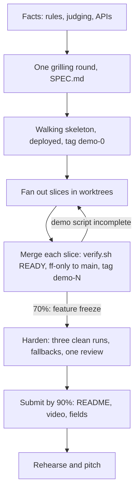

# hackathon-skill

My Claude Code setup for hackathons, game jams and demo days. The `hackathon-build` skill is my orchestrated build with the clock as the constraint: everything serves the demo the judges see.

## How it works

Claude is the orchestrator and owns the spec, the walking skeleton, the merges, the demo tags and the submission. Agents build slices in parallel worktrees; I and the team make the decisions.



The clock is planned backwards from the deadline:

| By | Done |
|---|---|
| 5% | Facts gathered, SPEC agreed |
| 15–20% | Walking skeleton: the whole demo path clickable on seed data, deployed |
| 70% | Feature freeze: whatever isn't merged is cut |
| 90% | Submitted |
| 100% | Rehearsed and pitched |

The phases:

0. Facts, time-boxed: judging criteria, prize tracks, submission fields, external API approvals
1. One grilling round, then a one-page `SPEC.md` whose demo script is the acceptance criteria
2. Repo: `main` always demos, secrets scanned before every push
3. Walking skeleton tagged `demo-0`, then slices fanned out in waves and fast-forward merged behind `verify.sh`
4. Freeze and harden: three clean demo runs on the deployed build, a fallback for every external call, one independent review
5. Submit: judges' README, demo video, submission fields, pitch prep

## Layout

```
hackathon-build/
  SKILL.md           the workflow
  templates/
    SPEC.md          one-page spec with the demo script
    brief.md         the brief every build agent reads first
```

## Install

This skill reuses scripts and templates from my [orchestrator-skill](https://github.com/owenbonc/orchestrator-skill) (`verify.sh`, `agent-setup.sh`, the hand-over note, the AGENTS.md template) and its standing rules, so install both side by side:

```bash
cp -R hackathon-build ~/.claude/skills/
cp -R orchestrated-build ~/.claude/skills/
```

Then tell Claude about the event ("hackathon", "build X in 24 hours"), or invoke it with `/hackathon-build`.

## Dependencies

`grilling` (mattpocock/skills), `ponytail`, `impeccable`, `emil-design-eng` and `claude-api` for API code. It is written for my setup (commit identity, GitHub account), so edit those before reusing it.
